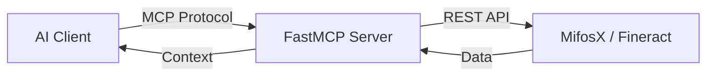

# MifosX Self Service MCP

MifosX Self Service MCP is a Model Context Protocol (MCP) server built using FastMCP (Python).
It exposes a set of AI-callable tools that allow MCP-compatible clients (such as Claude Desktop or DeepChat) to securely interact with the Apache Fineract / MifosX Self-Service APIs.

This project enables AI-driven banking workflows such as authentication, account access, beneficiary management, loans, savings, and transfers — while keeping all sensitive logic on the server side.

## Features

*   Register new self-service users.
*   Confirm user registration.
*   User login and authentication.
*   Manage client information.
*   Manage beneficiaries (add, list, update, delete).
*   View client accounts and transactions.
*   Manage loans (view products, applications, transactions, charges).
*   Manage savings accounts (products, applications, transactions, charges).
*   Manage guarantors for loans.
*   Manage share accounts and products.
*   Read account statements and spending insights (statement, summary, recurring payments).
*   Register for push notifications.
*   Perform third-party account transfers.

## Architecture

The MCP server acts as a secure bridge between your AI client and the Mifos/Fineract backend.



## Project Structure

```text
The codebase is organized into a modular, maintainable structure:

mcp-mifosx-self-service/
│
├── main.py              # MCP server entry point
├── mcp_app.py           # FastMCP app initialization
│
├── config/
│   └── config.py        # Environment-based configuration
│
├── routers/             # MCP tools grouped by domain
│   ├── auth_tools.py        # User registration & authentication
│   ├── client_tools.py      # Client information & accounts
│   ├── beneficiary_tools.py # Beneficiary management
│   ├── transfer_tools.py   # Third-party transfers
│   ├── loan_tools.py        # Loan products & accounts
│   ├── savings_tools.py     # Savings accounts & products
│   ├── statement_tools.py   # Statements, spending summary, recurring payments
│   ├── guarantor_tools.py  # Loan guarantor management
│   ├── shares_tools.py     # Share accounts & products
│   └── notification_tools.py # Push notification registration
│
├── schemas/             # Pydantic request/response models
│   ├── registration.py
│   ├── authentication.py
│   ├── confirm.py
│   ├── beneficiary.py
│   └── transfer.py
│
├── utils/               # Shared helpers
│   ├── http.py          # Centralized HTTP client
│   └── auth.py          # Auth helpers (Basic Auth)
│
├── resources/           # MCP resources (context & docs)
│   ├── overview.py
│   ├── endpoints.py
│   └── workflows.py
│
├── requirements.txt
├── Dockerfile
├── docker-compose.yml
└── README.md
```

## Installation

1.  **Clone the repository:**
    ```bash
    git clone https://github.com/openMF/mcp-mifosx-self-service.git
    cd mcp-mifosx-self-service
    ```

2.  **Create and activate a virtual environment (recommended):**
    ```bash
    python3 -m venv venv
    source venv/bin/activate  # On Windows: venv\Scripts\activate
    ```

3.  **Install the required dependencies:**
    ```bash
    pip install -r requirements.txt
    ```

## Configuration

The application connects to a Fineract API. Use environment variables (or a `.env` file) for customization:

| Variable | Description | Default |
|----------|-------------|---------|
| `MIFOS_BASE_URL` | Base URL of Fineract instance | `https://tt.mifos.community` |
| `MIFOS_TENANT` | Tenant identifier | `default` |

| `MIFOS_USERNAME` | Self-service username (optional, see below) | none |
| `MIFOS_PASSWORD` | Self-service password (optional, see below) | none |
| `MIFOS_STEP_UP_CHANNEL` | `EMAIL`, `SMS` or `TOTP`: how the verification code reaches the user (see below) | the authenticator app if the user paired one, otherwise the first channel the bank offers |
| `MIFOS_STEP_UP_ALLOW_CHAT_OTP` | `false` to forbid typing the code in the chat (see below) | `true` |
| `MIFOS_TRANSFER_MAX_AMOUNT` | Largest transfer the assistant may prepare; larger ones must be made in the bank's app | no limit |
| `MIFOS_TRANSFER_CONFIRM_TTL_SECONDS` | How long a prepared transfer can be confirmed | `300` |
| `MIFOS_TIMEZONE` | The bank's time zone (e.g. `America/Mexico_City`), used for the transfer date | server's time zone |

### Authentication

Tools do not take a username or password. The server keeps the login itself, so the AI never sees the
password or the access token. There are two ways to log in:

1. **Recommended:** set `MIFOS_USERNAME` and `MIFOS_PASSWORD` in the server environment (for example in the
   `env` block of the Claude Desktop config). Tools work right away, and the password never goes through the chat.
2. Ask the assistant to call the `login` tool. The server keeps the access token from Fineract and returns the
   login details without the token. Use `logout` to end the session.

The session lives in the server process. This is safe for the default stdio transport (one server per user);
do not share one server between several users.

## Transfers: prepare, then confirm

The assistant cannot move money in one call. Every transfer takes two tools:

1. `prepare_transfer(from_account_id, to_account_id, amount, description, ...)` moves no money. It checks that the
   source is one of your accounts and that the destination is one of your own accounts (for example a loan, for a
   repayment) or, with `third_party: true`, one of your saved beneficiaries. It checks the amount against
   `MIFOS_TRANSFER_MAX_AMOUNT` and the available balance, and returns a summary (accounts, amount, currency, fee)
   with a `confirmation_id`. The assistant shows you the summary and asks you to confirm.
2. `confirm_transfer(confirmation_id)` sends exactly the request that was prepared. The server keeps it, so the AI
   cannot change the accounts or the amount in between. The id works **once** and expires after
   `MIFOS_TRANSFER_CONFIRM_TTL_SECONDS` (5 minutes by default; at most 5 prepared transfers are kept). If your client
   supports MCP elicitation, it also shows you a form ("Send this ... ?") and nothing is sent unless you confirm
   there (if the form cannot be shown, nothing is sent either). If the bank asks for a one-time code, the confirmation continues as described below.

`cancel_transfer(confirmation_id)` drops a prepared transfer.

Applying for shares works the same way: `prepare_share_application` (checks the product's share limits and that
the linked savings account is the client's, active and in the product's currency, and returns the total price),
then `confirm_share_application` or `cancel_share_application`. A share confirmation id cannot confirm a
transfer, and the other way round. The bank still has to approve the application.

## Human-in-the-loop confirmation for sensitive tools

When the bank has step-up authentication turned on (selfservice-plugin, MX-488), some operations need a
one-time code that the **account owner** receives by e-mail or SMS: third-party transfers, transfers between
your own accounts, and password changes (`confirm_transfer`, `update_account_password`). All other tools are
unchanged.

The AI never sees the code or the one-time token the bank returns for it. The server asks for the code like this:

1. **The client supports MCP elicitation** (a form shown by the client). The tool shows a form such as
   "A verification code was sent to a***@example.com. Enter it to confirm: third-party transfer of 100.5 from
   account 11 to account 22." The person types the code there; it goes straight to this server and the tool
   finishes the transfer in the same call. A wrong code asks again (the form shows the attempts left); declining
   or cancelling the form stops the operation with `cancelled: true` and nothing is executed.
2. **The client does not support elicitation.** The tool answers `step_up_required` with a `challengeId`, a
   `summary` of what the code approves and the masked destination, and executes nothing. The assistant must ask
   **you** for the code and call `verify_step_up(challengeId, otp)`. Use `resend_step_up(challengeId)` if the code
   did not arrive (the bank limits how soon and how often). Typing the code in the chat means the code passes
   through the AI client and its logs: it is a one-time code that is tied to that one operation, but if you do not
   accept that, set `MIFOS_STEP_UP_ALLOW_CHAT_OTP=false`. Then, without elicitation, no code is sent at all and the
   tool tells the user to confirm in the bank's own app or website.

The request that runs after the code is accepted is the one that was approved. The server keeps it (it is not read
from the AI again), and the bank also ties the code to the accounts and the amount, so the AI cannot approve one
operation and run another. A waiting operation is kept in memory for 10 minutes and for at most 5 operations.

Step-up needs a login **session**: call `login`. Credentials from `MIFOS_USERNAME` / `MIFOS_PASSWORD` alone are
not enough for this step (the bank answers `session.required` and the tool says so). `MIFOS_STEP_UP_CHANNEL` picks
SMS or e-mail when the user has both; if that channel is not available the first one the bank offers is used.

### Authenticator app

If the bank also offers an **authenticator app** (Google Authenticator, Microsoft Authenticator...) and the user
paired one, the verification uses it (channel `TOTP`): nothing is sent, the person types the 6-digit code the app
shows now. By default the bank offers only the app to such a user (so an intercepted SMS is of no use), and this
server then uses it without any setting.

- **With elicitation** the form asks for "Code from your authenticator app" and, only for a lost phone, "Recovery
  code" (one of the codes the user saved when pairing; each works once). The form takes one of the two. A wrong
  code asks again, as before.
- **Without elicitation** the chat fallback accepts only the 6-digit code of the app, which is valid for seconds
  and for this one operation. A **recovery code is never accepted in the chat** (it is a long-lived credential);
  the tool tells the user to use a client with elicitation or the bank's own app. `resend_step_up` does not apply:
  an app code cannot be sent again.
- **Pairing, new recovery codes and removing the app are not tools.** The secret and the recovery codes must not
  pass through an AI conversation, so the user does that in the bank's own app or website.

## Running with Docker

The project includes Docker support for easy deployment:

```bash
# Build and run with docker-compose
docker-compose up --build
```

## Using with Claude Desktop (MCP)

* In Claude Desktop → Settings → Developer → Local MCP servers → Edit Config, add:

```json
{
  "mcpServers": {
    "mifos-banking": {
      "command": "/ABSOLUTE/PATH/TO/venv/bin/python",
      "args": [
        "/ABSOLUTE/PATH/TO/main.py"
      ],
      "env": {
        "MIFOS_BASE_URL": "https://tt.mifos.community",
        "MIFOS_TENANT": "default",
        "MIFOS_USERNAME": "your-username",
        "MIFOS_PASSWORD": "your-password"
      }
    }
  }
}
```
Restart Claude Desktop after saving.

## Running the Server

To run the MCP server, execute the following command from the project's root directory:

```bash
python3 main.py
```

## Example Usage (Natural Language) on Claude

Once the MCP server is connected, Claude can invoke the available tools automatically.
You can paste the following prompts in Claude Desktop to verify that your configuration is working correctly:

- Log in (only needed if `MIFOS_USERNAME` / `MIFOS_PASSWORD` are not set)
- Get my client information
- Show my client accounts
- List my beneficiaries
- Get my loan accounts
- Show my savings accounts

If these commands return valid responses, your MCP server is successfully connected and operational.

## Available MCP Tools

The MCP server exposes the following AI-callable tools.
Each tool internally maps to a Fineract self-service API call.
These tools are invoked by MCP-compatible AI clients, not directly via HTTP.

### Authentication

| Method | MCP Tool Name              | Description                              |
|--------|----------------------------|------------------------------------------|
| POST   | `register_self_service_existing_client` | Register a self-service user for an existing client |
| POST   | `confirm_self_service_user_registration` | Confirm the registration with the request id and token |
| POST   | `verify_user_registration` | Same as `confirm_self_service_user_registration` |
| GET    | `confirm_self_service_user_registration_status` | Check the registration: lists the clients the user can see |
| POST   | `login`                    | Log in and keep the session in the server |
| POST   | `authenticate_user_self_service` | Same as `login`                     |
| POST   | `logout`                   | End the session                           |
| PUT    | `update_account_password`  | Change the password (asks for a one-time code) |

### Client & Accounts

| Method | MCP Tool Name              | Description                              |
|--------|----------------------------|------------------------------------------|
| GET    | `get_clients_linked_to_user` | The clients linked to the logged-in user (gives the client id) |
| GET    | `get_client_details`       | Retrieve client information               |
| GET    | `get_client_accounts`      | Retrieve client accounts                  |
| GET    | `get_client_charges`       | Retrieve client charges                   |
| GET    | `get_client_images`        | Retrieve client images                    |
| GET    | `get_client_transactions`  | Retrieve client transactions              |
| GET    | `get_client_transaction_detail` | Retrieve one client transaction      |

### Beneficiaries

| Method | MCP Tool Name              | Description                              |
|--------|----------------------------|------------------------------------------|
| GET    | `get_beneficiary_list`     | List all beneficiaries                    |
| GET    | `get_beneficiary_template` | Get the template for creating beneficiaries |
| POST   | `create_beneficiary_savings` | Add a beneficiary with a savings account |
| POST   | `create_beneficiary_loan`  | Add a beneficiary with a loan account     |
| PUT    | `update_beneficiary_savings` | Update a savings beneficiary            |
| PUT    | `update_beneficiary_loan`  | Update a loan beneficiary                 |
| DELETE | `delete_beneficiary`       | Delete a beneficiary                      |

### Loans

| Method | MCP Tool Name                    | Description                              |
|--------|-----------------------------------|------------------------------------------|
| GET    | `get_loan_products`              | Retrieve available loan products         |
| GET    | `get_loan_product_details`       | Retrieve loan product details           |
| GET    | `get_loan_account_details`       | Retrieve loan account details           |
| GET    | `get_loan_transaction_detail`    | Retrieve loan transaction detail        |
| GET    | `get_loan_account_charges`       | Retrieve loan charges                    |
| GET    | `get_loan_template`              | Retrieve loan application template       |
| POST   | `calculate_loan_repayment_calendar` | Calculate loan repayment schedule    |
| POST   | `submit_loan_application`        | Submit loan application                  |
| PUT    | `update_loan_application`        | Update loan application                  |
| POST   | `withdraw_loan_application`      | Withdraw loan application                |

### Loan simulation (no login needed)

| Method | MCP Tool Name                   | Description                                              |
|--------|---------------------------------|----------------------------------------------------------|
| GET    | `get_loan_simulation_products`  | Loan products available for simulation, with their limits |
| POST   | `simulate_loan`                 | Estimate interest, total and installments for an amount   |

### Savings

| Method | MCP Tool Name                    | Description                              |
|--------|-----------------------------------|------------------------------------------|
| GET    | `get_savings_products`            | Get list of savings products             |
| GET    | `get_savings_product_details`     | Get savings product details              |
| GET    | `get_savings_account_details`     | Get savings account details              |
| GET    | `get_savings_account_transactions`| Get savings account transactions         |
| GET    | `get_savings_account_transaction_details` | Get transaction details          |
| GET    | `get_savings_account_charges`     | Get savings account charges              |
| GET    | `get_savings_account_template_raw`| Get savings account template             |
| POST   | `submit_savings_application`     | Submit savings account application       |
| PUT    | `update_savings_account_application` | Update savings account application    |

### Statements & Insights

Read-only tools that reshape a savings account's own transaction list into a statement
and spending picture. Everything is computed by the MCP server from the bank's rows —
see the "Honest limits" line in each tool's description.

| Method | MCP Tool Name              | Description                              |
|--------|----------------------------|------------------------------------------|
| GET    | `get_account_statement`    | Date- and direction-filtered statement of one savings account (paged, newest first) |
| GET    | `get_spending_summary`     | Money in / money out totals, monthly buckets and per-type breakdown |
| GET    | `find_recurring_payments`  | Same-amount, evenly-spaced debits (subscriptions, instalments) |

### Guarantors

| Method | MCP Tool Name              | Description                              |
|--------|----------------------------|------------------------------------------|
| GET    | `get_guarantor_template`  | Get template for creating guarantors      |
| GET    | `get_guarantor_list`      | Get list of guarantors for a loan        |
| POST   | `create_guarantor`        | Add a new guarantor for a loan           |
| PUT    | `update_guarantor`        | Update an existing guarantor              |
| DELETE | `delete_guarantor`        | Delete a loan guarantor                  |

### Shares

| Method | MCP Tool Name              | Description                              |
|--------|----------------------------|------------------------------------------|
| GET    | `get_share_product_list`  | Get list of share products               |
| GET    | `get_share_product_details` | Get share product details              |
| GET    | `get_share_account_template` | Share products a client can apply for; with `product_id`, price and share limits |
| GET    | `get_share_account`        | One share account or application        |
| -      | `prepare_share_application` | Step 1: check an application for shares and get a summary and a `confirmation_id` (submits nothing) |
| POST   | `confirm_share_application` | Step 2: submit the prepared application once, after the user confirmed |
| -      | `cancel_share_application` | Drop a prepared application |

### Notifications

| Method | MCP Tool Name                  | Description                              |
|--------|--------------------------------|------------------------------------------|
| GET    | `get_user_notification_details` | Get notification registration details  |
| POST   | `register_for_notifications`  | Register device for push notifications   |
| PUT    | `update_notification_registration` | Update notification registration     |

### Offices

| Method | MCP Tool Name              | Description                                   |
|--------|----------------------------|-----------------------------------------------|
| GET    | `get_offices`              | List the bank's offices (branches)            |
| GET    | `get_office_details`       | Details of one office                         |
| GET    | `get_office_services`      | Services an office offers, with working hours |
| GET    | `get_office_address`       | Street address of an office                   |
| GET    | `get_office_geolocation`   | Map location of an office                     |

### Profile and pockets

| Method | MCP Tool Name                  | Description                              |
|--------|--------------------------------|------------------------------------------|
| GET    | `get_user_details`             | The logged-in user's roles, permissions and clients (banks with OAuth login only; credentials are removed) |
| GET    | `get_pockets`                  | The accounts saved as favourites (pockets) |
| POST   | `add_accounts_to_pocket`       | Save the user's loan, savings or share accounts as favourites |
| POST   | `remove_accounts_from_pocket`  | Remove favourites by mapping id (from `get_pockets`) |
| GET    | `get_security_activity`        | Logins and sensitive actions (password, transfers, beneficiaries), newest first; filter by type |

### Transfers

| Method | MCP Tool Name                  | Description                              |
|--------|--------------------------------|------------------------------------------|
| GET    | `get_account_transfer_template` | Accounts you can transfer between       |
| GET    | `get_third_party_transfer_template` | Your accounts and saved beneficiaries for third-party transfers |
| GET    | `get_transfer_fees`            | List the bank's transfer fee rules (filter by type and currency) |
| POST   | `get_transfer_quote`           | Ask the bank for the exact fee and total of a transfer (moves no money) |
| -      | `prepare_transfer`            | Step 1: check a transfer and get a summary and a `confirmation_id` (moves no money) |
| POST   | `confirm_transfer`            | Step 2: send the prepared transfer once, after the user confirmed (may ask for a one-time code) |
| -      | `cancel_transfer`             | Drop a prepared transfer |
| POST   | `verify_step_up`              | Give the code the user received to the operation that waits for it (clients without elicitation) |
| POST   | `resend_step_up`              | Send the code again |

## License

This project is licensed under the terms included in the LICENSE file.

